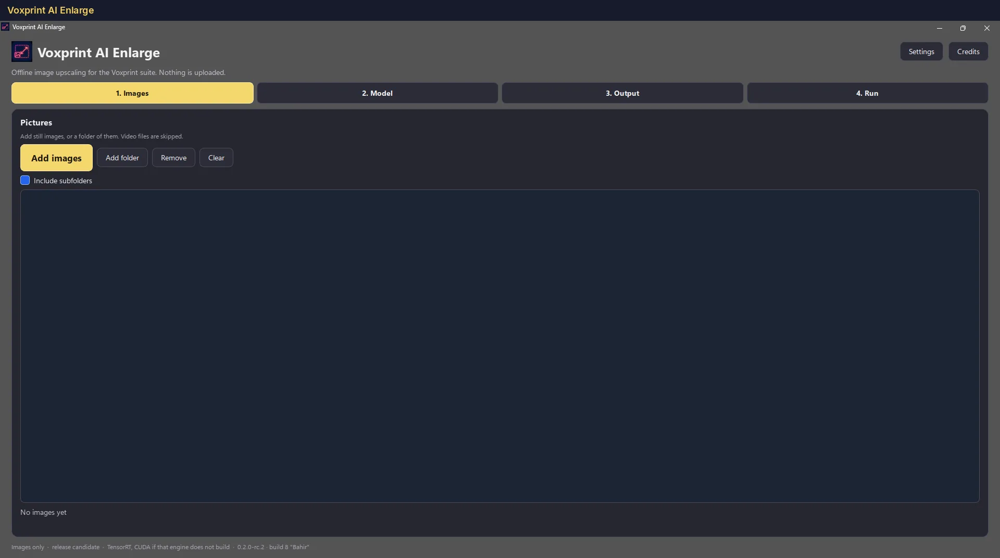
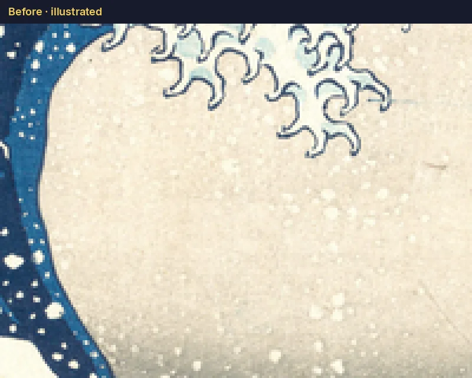
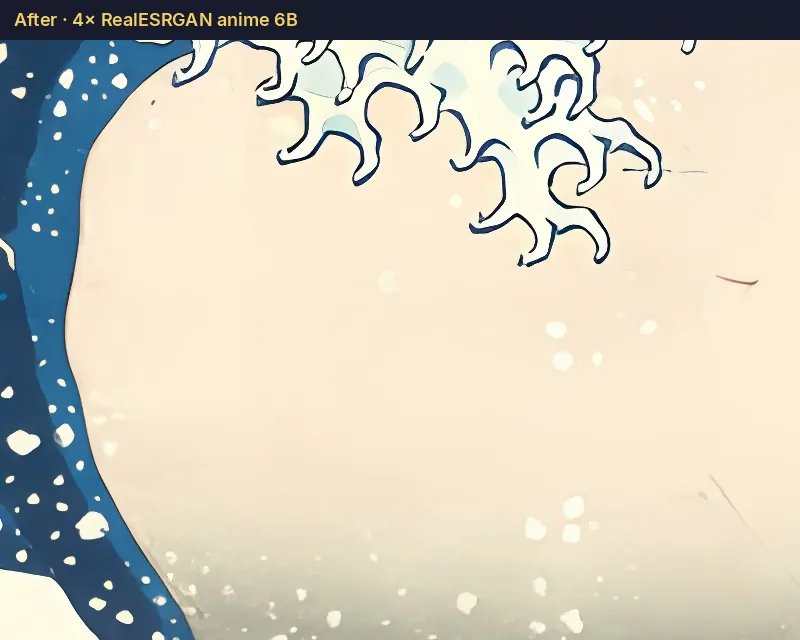
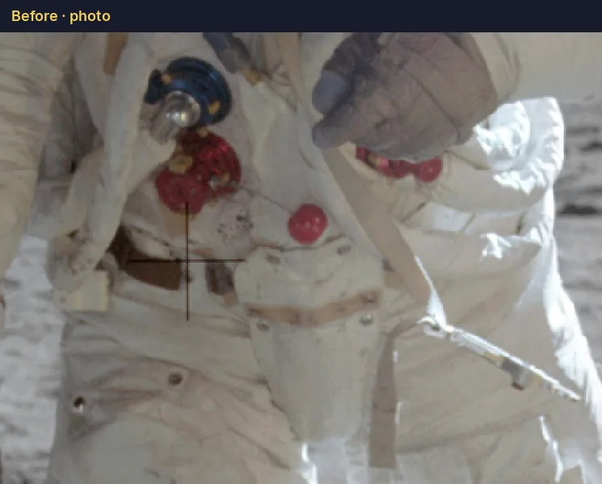
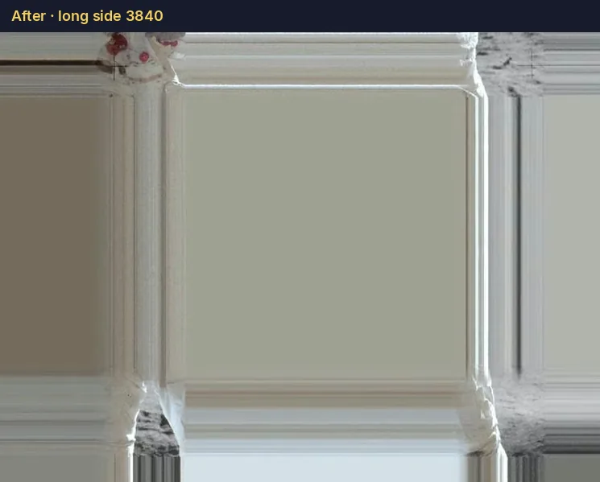

# Voxprint AI Enlarge

  

Offline image upscaling for the Voxprint suite. Nothing is uploaded.

Enlarge makes a still picture larger on your own computer. You pick images or a folder, pick a model, choose the scale and the file format, and run. The installer does not contain model weights. The first TensorRT engine for a model is built on your GPU and then cached.

* [Install](INSTALL.md)
* [Command-line contract](CLI.md)
* [Command-line reference](generated/cli-reference.md)
* [Roadmap](generated/roadmap.md)
* [Architecture](ARCHITECTURE.md)

The project README on GitHub is the install guide for Windows and Linux.

## Before and after

Illustrated picture, 4×:

  
  

Photograph, long side 3840:

  
  

